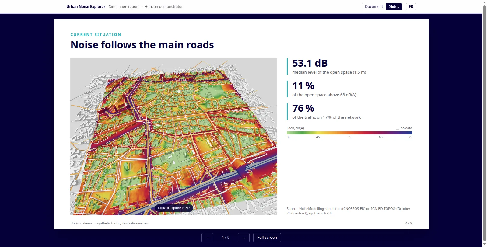

# Urban Noise Explorer — a noise study report with live 3D figures

An experimental **acoustic study report** of central Rennes (France), in English
and French. It reads like a consultancy report — cover, executive summary,
method, results, scenarios, conclusions, appendices — but its figures are not
pictures: each 3D figure is the noise simulation itself, rendered live in the
page, that the reader can turn, zoom and query building by building. Road and
rail traffic noise (Lden) is painted on every façade and on the ground, under
**what-if traffic scenarios**: zone 30, no heavy vehicles, car-free streets.
Everything runs in the browser.

[](https://oss.siradel.com/horizon-demo-urban-noise/)

**[▶ Live demo](https://oss.siradel.com/horizon-demo-urban-noise/)**

## Features

- A report layout (chapters, figures, tables, charts) that also switches to a
  **slide deck** (`?mode=slides`), with the same live 3D views
- Five live 3D figures sharing **one** Horizon viewer, which flies from figure
  to figure as you scroll or change slide
- Click a building, a street or a railway: noise level, height, use and
  synthetic traffic under the scenario shown
- Four traffic scenarios: current, zone 30, light vehicles, car-free streets
- Every chart, table and figure quoted in the text comes from the same data as
  the 3D views; works on phones

## Built with Horizon

Urban Noise Explorer is a demo of
[Horizon](https://github.com/siradel-oss/horizon), Siradel's open source real-time
3D engine for map data on a globe (WebAssembly, WebGL 2, TypeScript). It shows
3D Tiles buildings coloured by data textures (one material per scenario), a
float PMTiles raster coloured by a continuous palette, PMTiles vector layers
styled by script, picking of 3D tiles, vectors and raster values, and a single
viewer embedded in a long document, re-targeted from figure to figure. The 3D
Tiles and their façade data textures were produced with Siradel's data
processing components.

- Horizon: [website and documentation](https://horizon.oss.siradel.com) ·
  [getting started](https://horizon.oss.siradel.com/doc/getting_started.html) ·
  npm packages `@siradel-oss/horizon-{api,core,protocol}`
- More Horizon demos: [demo gallery](https://sce.oss.siradel.com/demos/)

> **A demonstrator, not an official noise map.** Horizon grew out of the
> [SCE](https://sce.oss.siradel.com) ecosystem. The traffic is synthetic (derived
> from the road importance) and the ground is flat, so the values are only
> illustrative. The official strategic noise maps of Rennes Métropole are
> [on data.gouv.fr](https://www.data.gouv.fr/datasets/cartographie-du-bruit-sur-rennes-metropole).

## En français

Urban Noise Explorer est un **rapport d'étude acoustique** expérimental sur le
centre de Rennes, lisible en document ou en présentation, dont les figures sont
des vues 3D vivantes : le bruit routier
et ferroviaire (Lden) sur les façades et au sol, et trois **scénarios de
trafic** (zone 30, sans poids lourds, rues sans voiture). Graphiques, tableaux
et chiffres du texte sont calculés à partir des mêmes données que les vues 3D.
Bâtiments 3D et textures de façades produits avec les briques de traitement
de données de Siradel. Démonstrateur du moteur 3D open source Horizon, en
français et en anglais, utilisable sur téléphone. Trafic synthétique et sol plat : ce n'est pas une
carte de bruit officielle.

## Run it

Requirements: Node.js ≥ 22.12, pnpm, and a browser with WebGL 2 and
`SharedArrayBuffer`.

```bash
pnpm install
pnpm dev        # http://localhost:5173
```

| Command        | Description                          |
| -------------- | ------------------------------------ |
| `pnpm dev`     | Development server                   |
| `pnpm build`   | Type-check and static build in `dist/` |
| `pnpm preview` | Serves the build locally             |

The build uses relative URLs (Vite base `./`), so `dist/` (about 20 MB with the
data) can be served under any subpath. `?lang=en|fr` forces the interface
language.

### Serving requirements

Horizon runs its WASM core across threads, which requires `SharedArrayBuffer`.
The static server must send these headers:

```
Cross-Origin-Opener-Policy: same-origin
Cross-Origin-Embedder-Policy: require-corp
```

It must also serve `.wasm` as `application/wasm` and accept HTTP `Range`
requests (the packed 3D Tiles and the PMTiles are read by range). The dev and
preview servers already do this (see `vite.config.ts`).

Hosts that cannot set headers, such as GitHub Pages, rely on the bundled
[coi-serviceworker](https://github.com/gzuidhof/coi-serviceworker) (MIT), which
adds them client-side. The `.github/workflows/deploy.yml` workflow builds and
publishes the app to GitHub Pages on every push to `main`.

## Stack and code map

- [Horizon](https://horizon.oss.siradel.com) 26.1, [SolidJS](https://www.solidjs.com),
  Tailwind CSS 4, Vite

```
src/
├── report/
│   ├── Report.tsx      # The report as a document: cover, summary, chapters, appendices
│   ├── Deck.tsx        # The same report as slides (1280 × 720, zoomed to fit)
│   ├── facts.tsx       # Findings and blocks shared by both (key figures, indicators, gains chart)
│   ├── views.ts        # Camera, scenario and layers of each 3D figure
│   ├── stats.json      # Figures of the report, pre-computed from public/data
│   └── stats.ts        # Types and formatting of those figures
├── components/
│   ├── Stage.tsx       # One Horizon canvas laid over the visible slot; Slot3D, Figure3D, tabs
│   ├── Charts.tsx      # Class distribution and bar charts, numbered exhibits
│   └── …               # Legend, info card, logo
├── horizon/viewer.ts   # Everything Horizon: init, scene, layers, picking, camera limits, show(view)
├── palette.ts          # Noise classes (5 dB steps), colours, scenarios, synthetic traffic
├── i18n.ts             # EN/FR; strings sit next to their component as { en, fr }
└── App.tsx             # Shell: top bar (Document / Slides, language), table of contents
public/data/            # Pre-computed buildings, façade textures, ground rasters, network
```

### One viewer, many figures

Each 3D figure is an empty slot in the text. `Stage` keeps a single canvas,
absolutely positioned over the slot that fills most of the screen, and calls
`viewer.show(view)` when that changes: the camera flies to the figure's view and
only the layers and scenario that differ are updated. A viewer per figure would
multiply GPU memory, and tearing a Horizon viewer down does not release it. The
canvas only receives pointer events once the reader clicks the figure. In the
deck, hidden slides stay mounted (`display: none`): their slots stay registered
and the stage follows the one on screen.

### How the buildings get their colours

The building tiles carry a `data` material variant whose texture is a templated
image URL (`SIRADEL_templated_image_url`, parameter `tileId`). The layer defines
one material per scenario, each pointing at `data/textures/<scenario>/{tileId}.png`
and colouring the float values with a continuous palette. Switching scenario
only changes the active material, and changing the palette only updates each
material's palette, so nothing is reloaded. Picking a building returns the Lden
at the clicked point.

## Data

The files in `public/data/` were pre-computed for a 2 km × 2 km area around
Place de la République. `src/report/stats.json` was pre-computed from them:
ground shares are area-weighted over the 1.5 m rasters, envelope shares are
weighted by façade and roof texture area, and road lengths come from the
network PMTiles. The processing chain itself (noise computation, 3D buildings,
textures, statistics) is not part of this repository.

| Source | Use | Licence |
| ------ | --- | ------- |
| IGN [BD TOPO®](https://geoservices.ign.fr/bdtopo), October 2026 extract | Buildings, roads and railways (geometry, height, width, use) | [Licence Ouverte 2.0](https://www.etalab.gouv.fr/licence-ouverte-open-licence/) |
| IGN Plan IGN v2 | Basemap of Figure 1, streamed from the Géoplateforme | Licence Ouverte 2.0 |

**Derived information.** The noise levels were computed for this project with
[NoiseModelling](https://noise-planet.org/noisemodelling.html) (CNOSSOS-EU), from the BD TOPO® geometry and **synthetic**
traffic derived from road importance, on flat ground. The 3D buildings (packed 3D
Tiles), façade data textures and ground tiles were produced with Siradel's
proprietary data processing components.
The levels are neither published nor validated by IGN or Rennes Métropole.

## License

Code: [MIT](LICENSE). Data keeps the licence of its producer (see above).
Dependencies are under permissive licences (MIT, BSD-3-Clause, Apache-2.0); the
Horizon WebAssembly core bundles third-party code whose notices are copied to
`dist/third-party-licenses.txt` at build time. Urban
Noise Explorer is not affiliated with Rennes Métropole, the City of Rennes or
IGN.

## Contact

Siradel open source: [opensource@siradel.com](mailto:opensource@siradel.com) ·
[www.siradel.com](https://www.siradel.com)
